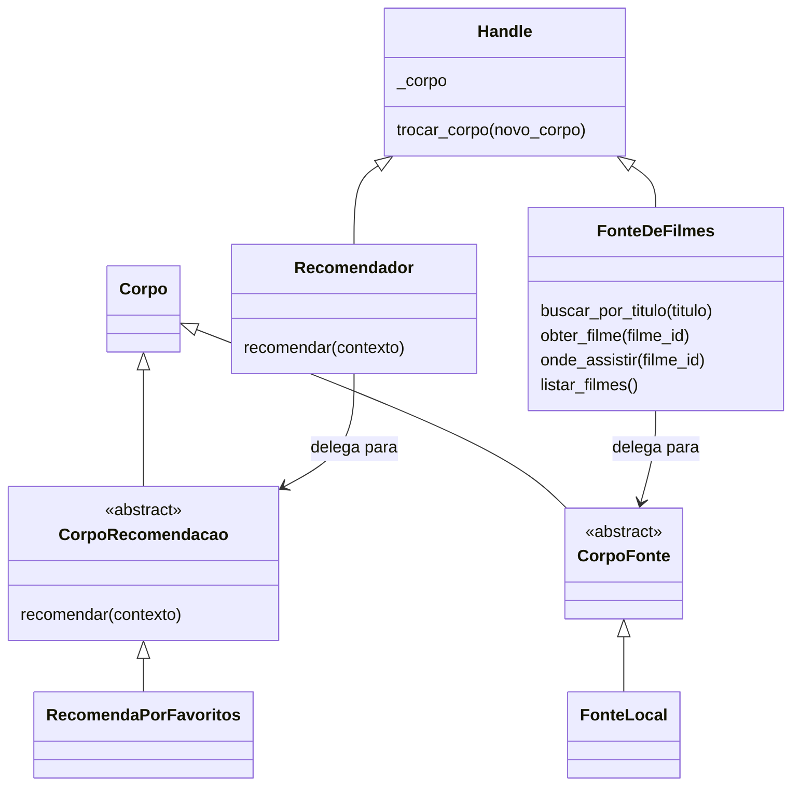

# Arquitetura do Streaming Recommendation

Este documento explica como o código está organizado, quais padrões de projeto usamos e por quê. Serve de guia para a equipe durante as sprints e de justificativa técnica na apresentação.

**Resumo**

- Arquitetura em **camadas**: tela → serviços → dados.
- **Handle/Body** (também chamado de **Bridge**) separa *quem usa* de *quem faz*. Usamos em dois lugares: a **recomendação** e a **fonte de filmes**.
- **Factory** escolhe qual implementação (Body) usar e entrega o objeto montado.
- Tecnologias: Python, Streamlit (telas) e SQLite3 (banco). Os filmes vêm de um **catálogo local em JSON**, gerado a partir da Streaming Availability API.
- A recomendação é **baseada em conteúdo** (gêneros dos favoritos) e funciona como **apoio à decisão**. Não usamos filtragem colaborativa.

---

## 1. Estrutura de pastas

```
streaming_reccomendation/
├── app.py                  # entrada do sistema (streamlit run app.py)
├── fabricas.py             # Factory: escolhe o Body certo
├── requirements.txt
├── .streamlit/config.toml  # tema do Streamlit
├── assets/                 # logo
│
├── ui/                     # TELAS (Streamlit)
│   ├── busca.py            #   buscar filmes e favoritar
│   ├── listas.py           #   minha lista de favoritos
│   ├── recomendacoes.py    #   streamings recomendados, planos e preços
│   ├── navegacao.py        #   páginas e menu
│   ├── identidade.py       #   nome, logo e estilo do app
│   └── componentes.py      #   pedaços de tela reaproveitados
│
├── servicos/               # REGRAS DE NEGÓCIO (sem tela)
│   ├── busca_servico.py
│   ├── favoritos_servico.py
│   ├── recomendacao_servico.py
│   └── streamings_servico.py   # streamings com seus planos e preços
│
├── recomendacao/           # HANDLE/BODY da recomendação
│   ├── recomendador.py         # Handle
│   ├── corpo_recomendacao.py   # Body (contrato)
│   └── por_favoritos.py        # Body concreto
│
├── fontes/                 # HANDLE/BODY da fonte de filmes
│   ├── fonte_de_filmes.py      # Handle
│   ├── corpo_fonte.py          # Body (contrato)
│   ├── fonte_local.py          # Body concreto: lê o catálogo em JSON
│   └── filmes_local.json       # catálogo (gerado pelo script)
│
├── core/
│   └── handle_body.py      # classes base Handle e Corpo (o "Bridge.h" em Python)
│
├── models/                 # objetos de dados
│   ├── filme.py
│   ├── streaming.py            # Streaming com a lista de Plano
│   ├── plano.py
│   ├── usuario.py
│   └── contexto_recomendacao.py  # entrada e saída da recomendação
│
├── dados/                  # BANCO (SQLite3)
│   ├── schema.sql              # tabelas
│   ├── conexao.py              # abre conexão e cria as tabelas
│   └── carga_inicial.py        # usuário demo, streamings, planos e preços
│
├── scripts/
│   └── atualizar_catalogo.py   # gera/atualiza fontes/filmes_local.json pela API
│
├── tests/                  # testes (pytest)
└── docs/                   # planejamento das sprints e documento de design
```

| Pasta | Responsabilidade | O que **não** faz |
|---|---|---|
| `ui/` | Desenhar telas e chamar serviços | Acessar banco, API ou fazer cálculo de recomendação |
| `servicos/` | Juntar as peças e aplicar regras | Desenhar tela (não importa `streamlit`) |
| `recomendacao/` | Decidir qual streaming recomendar | Ler banco ou API: recebe os dados prontos |
| `fontes/` | Entregar filmes e dizer onde cada um está disponível | Conhecer regras de recomendação |
| `dados/` | Guardar e ler favoritos, streamings e planos | Conhecer telas |
| `models/` | Representar os dados | Ter lógica |
| `scripts/` | Preparar o catálogo, fora do app | Ser chamado pelo app em tempo de execução |

---

## 2. Camadas e a regra de dependência

```
┌──────────────────────────┐
│   ui/  (Streamlit)       │   só chama servicos
└────────────┬─────────────┘
             ▼
┌──────────────────────────┐
│   servicos/              │   usa Handles (via fabricas) e dados
└───────┬──────────┬───────┘
        ▼          ▼
┌─────────────┐  ┌──────────┐
│ recomendacao│  │  dados/  │
│ fontes/     │  │ (SQLite) │
│ (Handle/Body)  └──────────┘
└─────────────┘
```

**A regra:** cada camada só chama a de baixo. A tela nunca fala com o banco, e o serviço nunca desenha nada.

**Por que isso importa no Streamlit:** o Streamlit roda tudo em Python no mesmo processo, então é fácil misturar tela e lógica sem perceber. Se a lógica de recomendação ficar dentro do arquivo da tela, ninguém consegue trabalhar em paralelo sem conflito de merge. Com as camadas, quatro pessoas editam quatro arquivos diferentes.

---

## 3. Handle/Body (Bridge)

### 3.1 A ideia em uma frase

Em vez de a tela usar diretamente a classe que faz o trabalho, ela usa uma classe **Handle** ("cabo", a parte que se segura) que **repassa** cada chamada para uma classe **Body** ("corpo", quem realmente faz). Como o Handle só segura uma referência, dá para trocar o Body por outro sem que quem usa o Handle perceba.

> **Analogia:** o interruptor da parede (Handle) funciona igual para qualquer lâmpada (Body). Você troca a lâmpada e continua apertando o mesmo interruptor.

### 3.2 O que o arquivo C++ (`handleBodySemDebug.h`) faz

O arquivo tem duas classes:

**`Handle<T>`** é um *template*, onde `T` é o tipo do Body.
- `T* pImpl_` é o ponteiro para o Body.
- O **construtor** faz `pImpl_ = new T` (cria o Body) e chama `attach()`.
- O **destrutor** chama `detach()`.
- O **construtor de cópia** e o **operator=** fazem o novo Handle apontar para o **mesmo** Body, chamando `attach()` (e `detach()` no antigo, no caso do `=`).

**`Body`** tem um contador, `refCount_`.
- `attach()` faz `refCount_++`.
- `detach()` faz `--refCount_` e, se chegar a zero, executa `delete this`.
- O construtor de cópia é privado: ninguém copia o Body, só os Handles.

**Resumindo:** vários Handles podem apontar para um único Body, e o Body se apaga sozinho quando o último Handle some. Essa versão do padrão mistura duas ideias:

1. **Bridge:** separar interface (Handle) de implementação (Body).
2. **Contagem de referências:** gerenciar a memória, porque em C++ alguém precisa dar o `delete`.

### 3.3 Tradução C++ → Python

Em Python, a ideia **1** continua existindo. A ideia **2** não é necessária, porque o interpretador faz isso sozinho.

| C++ (`Bridge.h`) | Python (este projeto) |
|---|---|
| `template <class T> class Handle` | `class Handle` (sem template; Python não precisa declarar o tipo) |
| `T *pImpl_` | `self._corpo` |
| `Handle() { pImpl_ = new T; attach(); }` | `__init__(self, corpo)`: o Body já chega pronto (quem cria é a **Factory**) |
| `~Handle() { detach(); }` | não existe: o Python libera sozinho |
| `Handle(const Handle&)` (construtor de cópia) | `copy.copy(handle)` (ver 3.5) |
| `operator=` | atribuição normal: `h2 = h1` |
| `class Body` com `refCount_`, `attach()`, `detach()` | não existe: o Python conta as referências |
| `delete this` | automático |
| `Body(const Body&)` privado | convenção: não copiamos Body |
| `virtual ~Body()` | não existe |
| métodos `virtual ... = 0` | `@abstractmethod` em uma classe que herda de `ABC` |

**Uma diferença importante:** no C++, o Handle cria o Body sozinho (`new T`). Aqui o Handle **recebe** o Body pronto. Isso é mais flexível, porque o Handle nem precisa saber qual classe concreta existe. Quem decide é a Factory.

### 3.4 Por que não precisa de `attach`/`detach` em Python

O Python (CPython, o interpretador padrão) guarda quantas variáveis apontam para cada objeto. Quando esse número chega a zero, o objeto é apagado. É exatamente o que o `refCount_` fazia na mão. Dá para ver isso acontecendo:

```python
import sys, copy
corpo = RecomendaPorFavoritos()
print(sys.getrefcount(corpo))   # 2  (a variável 'corpo' + o próprio argumento da função)
r1 = Recomendador(corpo)
print(sys.getrefcount(corpo))   # 3  (r1._corpo passou a apontar para ele)
r2 = copy.copy(r1)
print(sys.getrefcount(corpo))   # 4  (r2._corpo também aponta)
del r2
print(sys.getrefcount(corpo))   # 3  (voltou a diminuir)
```

O `getrefcount` sempre soma 1 pelo argumento que recebe, então os números podem variar um pouco conforme a versão do Python. O comportamento é o importante: o contador sobe e desce sozinho.

### 3.5 O equivalente do construtor de cópia

No C++, copiar um Handle faz os dois apontarem para o **mesmo** Body. Em Python, `copy.copy` faz exatamente isso (cópia "rasa"):

```python
h1 = criar_recomendador("favoritos")
h2 = copy.copy(h1)

h2 is h1                # False -> são dois Handles diferentes
h2._corpo is h1._corpo  # True  -> os dois compartilham o mesmo Body
```

Atribuir (`h2 = h1`) é ainda mais simples: as duas variáveis apontam para o mesmo Handle.

### 3.6 Como fica no projeto

A base está em `core/handle_body.py`:

```python
class Corpo(ABC):
    """Body: classe base de todas as implementações reais."""

class Handle:
    def __init__(self, corpo: Corpo):
        self._corpo = corpo          # o pImpl_ do C++

    def trocar_corpo(self, novo_corpo: Corpo):
        self._corpo = novo_corpo
```

Usamos o padrão em **dois** lugares:

**a) Recomendação**

| Papel | Classe | Arquivo |
|---|---|---|
| Handle | `Recomendador` | `recomendacao/recomendador.py` |
| Body (contrato) | `CorpoRecomendacao` | `recomendacao/corpo_recomendacao.py` |
| Body concreto | `RecomendaPorFavoritos` (e, nas próximas sprints, o de watchlist e o que combina os dois) | `recomendacao/` |

**b) Fonte de filmes**

| Papel | Classe | Arquivo |
|---|---|---|
| Handle | `FonteDeFilmes` | `fontes/fonte_de_filmes.py` |
| Body (contrato) | `CorpoFonte` | `fontes/corpo_fonte.py` |
| Body concreto | `FonteLocal` | `fontes/fonte_local.py` |



O Handle repassa a chamada:

```python
class Recomendador(Handle):
    def recomendar(self, contexto):
        return self._corpo.recomendar(contexto)   # só repassa
```

E cada Body implementa a lógica própria:

```python
class RecomendaPorFavoritos(CorpoRecomendacao):
    def recomendar(self, contexto):
        ...   # aqui fica a regra de verdade
```

**O que ganhamos:** a recomendação por watchlist (Sprint 3) é *adicionar um arquivo novo*, sem mexer no que foi feito na Sprint 2. E a fonte de filmes pode ser trocada (por exemplo, para consultar a API ao vivo em vez de ler o JSON) sem mexer em nenhum serviço nem tela.

### 3.7 Por que o Body recebe um `ContextoRecomendacao`

Os Bodies de recomendação **não leem o banco**. O serviço junta os dados (favoritos, catálogo, onde cada filme está disponível) em um objeto `ContextoRecomendacao` e entrega ao Recomendador. Isso deixa cada regra uma função simples: *entra contexto, sai lista de streamings*. É mais fácil de entender, de dividir entre pessoas e de testar.

### 3.8 O que dizer à professora

> Adotamos o padrão **Handle/Body (Bridge)** para separar a interface de uso da implementação. Diferente da versão em C++ vista em aula, não implementamos a contagem de referências manualmente (`attach`/`detach`), pois em Python o próprio interpretador gerencia a memória. Mantivemos o essencial do padrão: o Handle guarda a referência para o Body e delega as chamadas a ele, o que permite adicionar novas formas de recomendação e trocar a fonte de dados sem alterar o restante do sistema.

---

## 4. Factory

### O que é

Uma função que **decide qual Body criar** e devolve o Handle já montado. Quem pede só diz *o que quer*, e a fábrica cuida de *como montar*.

### Onde está

`fabricas.py`:

```python
_CORPOS_FONTE = {
    "local": FonteLocal,
}

_CORPOS_RECOMENDACAO = {
    "favoritos": RecomendaPorFavoritos,
}

def criar_fonte_de_filmes(tipo: str = "local") -> FonteDeFilmes:
    if tipo not in _CORPOS_FONTE:
        raise ValueError(f"Tipo de fonte desconhecido: {tipo!r}")
    return FonteDeFilmes(_CORPOS_FONTE[tipo]())

def criar_recomendador(tipo: str = "favoritos") -> Recomendador:
    if tipo not in _CORPOS_RECOMENDACAO:
        raise ValueError(f"Tipo de recomendação desconhecido: {tipo!r}")
    return Recomendador(_CORPOS_RECOMENDACAO[tipo]())
```

### Por que ajuda

- Quando o seletor da tela (Sprint 3) devolver um texto como `"watchlist"`, a fábrica transforma esse texto no objeto certo, sem `if/else` espalhado pelo código.
- Trocar a fonte de filmes é mudar **uma linha** na fábrica.

---

## 5. Fluxo completo: o usuário pede uma recomendação

```
1. ui/recomendacoes.py      a tela chama o serviço
        │
        ▼
2. servicos/recomendacao_servico.recomendar(usuario_id)
        │
        ├─► busca os favoritos do usuário (favoritos_servico → dados)
        ├─► se tiver menos de 3 favoritos, devolve lista vazia
        ├─► fabricas.criar_fonte_de_filmes()
        │        carrega o catálogo (listar_filmes) e, para cada filme,
        │        pergunta onde está disponível (onde_assistir)
        ├─► monta o ContextoRecomendacao
        └─► fabricas.criar_recomendador("favoritos")
        │        devolve Recomendador(RecomendaPorFavoritos())
        ▼
3. recomendador.recomendar(contexto)
        │   (Handle repassa)
        ▼
4. RecomendaPorFavoritos.recomendar(contexto)    ← a regra de verdade
        │
        ▼
5. lista de StreamingRecomendado (nome, pontuação, filmes compatíveis
   e gênero) volta até a tela, que mostra o ranking com planos e preços
```

Os planos e preços vêm da tabela `planos` (ver seção 7), pelo serviço `streamings_servico`.

---

## 6. Fonte de dados dos filmes

**Decisão:** o sistema lê um **catálogo local em JSON** (`fontes/filmes_local.json`). Esse arquivo não é escrito à mão: é gerado pelo script `scripts/atualizar_catalogo.py`, que consulta a **Streaming Availability API (v4)** para o Brasil.

Por que assim:

- O app abre rápido e funciona sem internet e sem chave de API, o que ajuda nas demonstrações.
- O catálogo é grande e traz a disponibilidade real de cada filme por streaming, o que a recomendação precisa.
- A chave da API fica fora do código (arquivo `.env`, que está no `.gitignore`) e só o script a usa.

Formato do arquivo:

```json
{
  "atualizado_em": "2026-11-24",
  "fonte": "Streaming Availability API v4",
  "pais": "br",
  "filmes": [
    {
      "id": 1,
      "titulo": "The Godfather",
      "ano": 1972,
      "generos": ["Crime", "Drama"],
      "streamings": ["HBO Max"],
      "imdb_id": "tt...",
      "tmdb_id": "movie/..."
    }
  ]
}
```

Em `favoritos`, o banco guarda só o **id** do filme. Os dados do filme vêm sempre do catálogo.

Para atualizar o catálogo, veja as instruções no cabeçalho do próprio `scripts/atualizar_catalogo.py`.

**Cuidados com os dados**

- Os nomes de streaming do catálogo precisam ser **idênticos** aos nomes cadastrados na tabela `streamings` (por exemplo, `HBO Max`, e não `Max`). O teste `tests/test_catalogo_streamings.py` garante isso e falha avisando quais nomes ficaram sem cadastro.
- Alguns filmes vêm da API sem gênero. A recomendação os ignora na contagem.
- A disponibilidade vale para o Brasil, na data de `atualizado_em`.

---

## 7. Banco de dados (SQLite3)

O arquivo `dados/streaming.db` não vai para o Git: ele é criado e preenchido ao iniciar o app.

| Tabela | Colunas | Para quê |
|---|---|---|
| `usuarios` | `id`, `nome` | Perfil de demonstração. A autenticação real chega na Sprint 3 |
| `favoritos` | `usuario_id`, `filme_id`, `criado_em` | Filmes que o usuário favoritou (só o id do filme) |
| `streamings` | `id`, `nome` | Os serviços de streaming cadastrados |
| `planos` | `id`, `streaming_id`, `nome`, `preco_mensal`, `conferido_em` | Planos e preços de cada streaming |

**Planos e preços** são dados fixos, carregados por `dados/carga_inicial.py` (`garantir_streamings_e_planos`). Valem estes cuidados:

- O preço é o **mensal**, sem promoções e sem combos de operadora.
- `conferido_em` registra o dia em que o preço foi conferido nos sites oficiais. Preço de streaming muda com frequência, então é a data que diz até quando o dado é confiável.
- Cadastrar de novo é seguro: a carga atualiza o que já existe (`ON CONFLICT ... DO UPDATE`) e não duplica.
- Para ler tudo, `servicos/streamings_servico.listar_streamings_com_planos()` devolve uma lista de `Streaming`, cada um com sua lista de `Plano`, do mais barato ao mais caro.

**Ligação entre filmes e streamings:** é feita pelo **nome**. O catálogo diz, para cada filme, em quais nomes de streaming ele está, e a tabela `streamings` usa os mesmos nomes. Streamings que aparecem no catálogo e ainda não têm cadastro são detectados pelo teste citado na seção 6.

---

## 8. Critério de recomendação

A recomendação desta etapa usa **só os favoritos**, e é **baseada em conteúdo**: ela olha as características dos filmes que o usuário escolheu (os gêneros), e não o comportamento de outros usuários.

1. **Mínimo de favoritos:** a recomendação só roda com pelo menos **3** filmes favoritos (`MIN_FAVORITOS`). Antes disso, a tela avisa que faltam favoritos.
2. **Gênero favorito:** é o gênero que mais se repete entre os filmes favoritos. A comparação ignora maiúsculas e espaços, e, em caso de empate, vale o primeiro gênero encontrado.
3. **Pontuação por streaming:** para cada streaming, contamos quantos filmes **desse gênero** do catálogo estão disponíveis nele.
4. **Ranking:** do streaming com mais filmes do gênero para o com menos. Em empate, vale a ordem do catálogo.
5. **Resultado:** para cada streaming, o `StreamingRecomendado` traz o nome, a pontuação, os filmes compatíveis e o gênero usado. A tela junta isso com os planos e preços.

Um exemplo: se dois dos três favoritos são "Drama" e um é "Crime", o gênero favorito é Drama. O streaming que tiver mais filmes de Drama no catálogo fica em primeiro.

A lógica está no `RecomendaPorFavoritos`, que recebe um `ContextoRecomendacao` pronto e não acessa banco nem API.

**Por que apoio à decisão:** o sistema não promete que o usuário vai gostar de um serviço. Ele mostra, com um critério simples e explicável, onde há mais títulos parecidos com os que ele já escolheu, e quanto custa. A decisão de assinar continua sendo da pessoa.

**Limites assumidos**

- **Sem filtragem colaborativa.** Ela precisaria de uma base de usuários e de avaliações, que o projeto não tem. Em troca, o critério é transparente: dá para ver por que cada serviço aparece naquela posição.
- Só os gêneros contam. Diretor, elenco, nota e época do filme não entram.
- A qualidade do resultado depende da qualidade do catálogo (gêneros e disponibilidade vindos da API).
- Os preços são fixos e conferidos à mão, então podem ficar desatualizados.

---

## 9. Como estender

### Nova forma de recomendar

1. Criar `recomendacao/por_watchlist.py` com uma classe que herda de `CorpoRecomendacao` e implementa `recomendar(self, contexto)`.
2. Registrar em `fabricas.py`: `"watchlist": RecomendaPorWatchlist`.
3. Colocar a opção `"watchlist"` no seletor da tela.

**Nenhum outro arquivo muda.** Esse é o teste de que o padrão está funcionando.

### Nova fonte de filmes (ex.: consultar a API ao vivo)

1. Criar `fontes/fonte_api.py` com uma classe que herda de `CorpoFonte` e implementa os métodos do contrato (`buscar_por_titulo`, `obter_filme`, `onde_assistir`, `listar_filmes`).
2. Registrar em `fabricas.py`: `"api": FonteApi`.
3. Trocar o padrão de `criar_fonte_de_filmes(tipo="local")` para `"api"`.

Chaves de API **nunca** vão para o repositório. Usem o arquivo `.env` ou o `.streamlit/secrets.toml`, ambos já no `.gitignore`.

### Novo streaming

Adicionar o nome e os planos em `CATALOGO_STREAMINGS`, em `dados/carga_inicial.py`, usando o **mesmo nome** que o catálogo traz, e ajustar `DATA_CONFERENCIA`.

---

## 10. Sprints

O planejamento completo está em `docs/sprints.md`. Resumo:

| Sprint | Período | Entrega |
|---|---|---|
| 1 | 22/10 a 04/11 | Buscar filmes, favoritar, ver e remover favoritos |
| 2 | 05/11 a 18/11 | Recomendação com base nos favoritos, com planos e preços (H3 e H7) |
| 3 | 19/11 a 02/12 | Cadastro e login, watchlist e recomendação com base nela (H1, H4 e H5) |
| 4 | 03/12 a 16/12 | Testes, correções e apresentação |

---

## 11. Convenções

- **Nomes no código em português**, como a documentação (`buscar_filmes`, `RecomendaPorFavoritos`).
- Classes em `PascalCase`; funções, variáveis e arquivos em `snake_case`.
- `ui/` só chama `servicos/`. `servicos/` não importa `streamlit`.
- Os Bodies de recomendação não acessam banco nem API: recebem o `ContextoRecomendacao`.
- **Git:** `main` guarda as versões de fim de sprint (com tag), `develop` é onde o trabalho se junta e cada sub-história tem uma branch `feature/...` que sai da `develop`. Ninguém commita direto na `main` nem na `develop`.
- Mensagem de commit começa com o código da sub-história e da issue: `H3.1 (#32): cadastra streamings, planos e preços`.
- Todo trabalho entra por **Pull Request para a `develop`**, com revisão de outra pessoa do grupo.
- O arquivo do banco (`*.db`), o `.venv`, o `.env` e chaves de API não vão para o Git.
- Testes com `pytest`: `python -m pytest -q`.

---

## 12. Pontos em aberto

Resolvidos:

| Ponto | Decisão |
|---|---|
| Fonte de dados dos filmes | Catálogo local em JSON, gerado pela Streaming Availability API |
| Critério de recomendação | Gênero favorito mais frequente, ranking por quantidade de filmes do gênero em cada streaming (seção 8) |
| Ligação entre streamings do catálogo e a tabela `streamings` | Pelo nome, protegida por teste (seção 7) |
| Formato dos filmes no banco | O banco guarda só o id; os dados vêm do catálogo |

Ainda abertos:

| Ponto | Observação |
|---|---|
| Planos e preços na tela de recomendações | O `recomendacao_servico` ainda usa planos de exemplo. A troca por `listar_streamings_com_planos` é a H7 |
| Filmes sem gênero no catálogo | Em 24/11/2026, 41 de 7.302. O teste `test_listar_filmes_devolve_o_catalogo_com_generos` falha por causa deles |
| Nome `Max` vs `HBO Max` | O script de catálogo deve padronizar para `HBO Max` |
| Hospedagem | A definir |

---

## 13. Como rodar

```bash
python -m venv .venv
source .venv/bin/activate          # no Windows (PowerShell): .venv\Scripts\Activate.ps1
pip install -r requirements.txt
streamlit run app.py
```

Na primeira execução, o app cria o banco `dados/streaming.db`, o usuário de demonstração e carrega streamings, planos e preços.

Para rodar os testes:

```bash
python -m pytest -q
```
